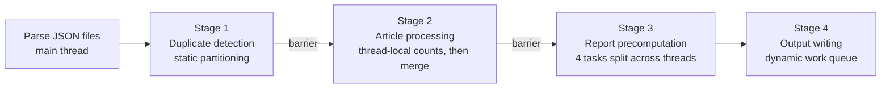
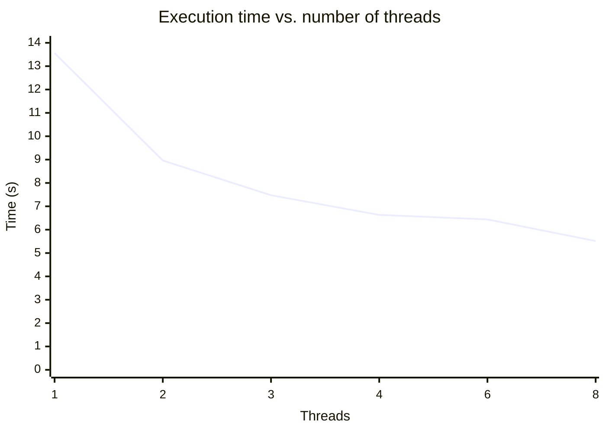

# NewsOrganizer


A multithreaded Java engine that processes large collections of news articles stored as JSON. It removes duplicates, groups articles by category and language, counts keyword frequencies, and writes a summary report.

On the full dataset (**~17,700 articles, 16,571 unique**), it runs **2.46x faster on 8 threads** than on 1, and the output is identical for every thread count.

## Features

- **Duplicate detection** by UUID and by title, using lock-free `putIfAbsent` on `ConcurrentHashMap`
- **Grouping** of articles by category and by language, one output file per group
- **Keyword frequency analysis** for English articles: tokenization, normalization and stop-word filtering (140 linking words)
- **Summary report**: duplicate count, top author, top language, top category, most recent article, top keyword
- **Deterministic output**: the results are the same for any number of threads

## Architecture

Processing runs in four stages separated by a `CyclicBarrier`. No thread starts a stage until every thread has finished the previous one.



1. **Duplicate detection.** The parsed files are split evenly across threads (`start = id * n/P`). Each thread registers UUIDs and titles in concurrent maps, and collisions are recorded as duplicates.
2. **Article processing.** Threads skip duplicates and index the remaining articles by category, language and author. Word and author counts are first collected in **thread-local `HashMap`s** and then merged into the shared `ConcurrentHashMap<String, AtomicInteger>`, which keeps contention low on the hot path.
3. **Report precomputation.** The four aggregations (totals plus most recent article, top category, top language, top author) are divided among threads. Per-thread partial results are combined without locks.
4. **Output writing.** Write tasks go into an `ArrayBlockingQueue`, and threads pull them dynamically, because file sizes vary a lot. The most expensive tasks (`keywords_count.txt`, `all_articles.txt`) are queued first, so the long tasks start early instead of finishing last.

### Concurrency primitives

| Primitive | Used for |
|---|---|
| `ConcurrentHashMap` / `ConcurrentHashMap.newKeySet()` | article index, duplicates, authors, languages, categories, words |
| `AtomicInteger` | shared occurrence counters |
| `Collections.synchronizedList` | per-category and per-language article lists |
| `ArrayBlockingQueue` | dynamic distribution of write tasks |
| `CyclicBarrier` | synchronization between stages |

## Performance

Measured on an Intel Core i7-12700H (14 cores) under WSL Ubuntu with Java 17, on the full dataset of ~17,700 articles. Each value is the average of 3 runs.



| Threads | 1 | 2 | 3 | 4 | 6 | 8 |
|---|---|---|---|---|---|---|
| Avg. time (s) | 13.561 | 8.962 | 7.475 | 6.633 | 6.440 | 5.514 |
| Speedup | 1.00 | 1.51 | 1.81 | 2.04 | 2.11 | **2.46** |
| Efficiency | 1.00 | 0.76 | 0.61 | 0.51 | 0.35 | 0.31 |

**Analysis**

- From 1 to 4 threads, the execution time halves. Beyond 4 threads the curve flattens, so 4 threads give the best balance between speed and efficiency.
- The speedup stays below linear for three reasons:
  - **Amdahl's law.** JSON parsing happens sequentially before the workers start.
  - **Contention** on the shared concurrent structures and waiting at the barriers.
  - **Long output tasks.** Writing `keywords_count.txt` and `all_articles.txt` takes the longest, so other threads can run out of work while these finish.

## Getting started

Requires **Java 17+**. The Jackson jars are bundled in `src/libs`.

```bash
git clone https://github.com/alex1bondoc/NewsOrganizer.git
cd NewsOrganizer/src
make run                # 4 threads on the bundled sample dataset
make run THREADS=8      # choose the number of threads
make run ARGS="<threads> <articles.txt> <inputs.txt>"   # custom input
make clean
```

### Input format

- `articles.txt`: the first line holds the number of JSON files, followed by one path per line (relative to `articles.txt`).
- `inputs.txt`: the paths to the language list, the category list and the linking-words list.
- Each JSON file holds an array of articles with `uuid`, `title`, `author`, `url`, `published`, `language`, `text` and `categories`.

`src/input/sample/` contains a small synthetic dataset (80 articles, including duplicates) so the project runs right after cloning.

### Output

| File | Content |
|---|---|
| `<Category>.txt`, `<language>.txt` | sorted UUIDs of the articles in each group |
| `all_articles.txt` | all unique articles, newest first |
| `keywords_count.txt` | English keyword frequencies, sorted by count |
| `reports.txt` | summary statistics |

Example `reports.txt` on the full dataset:

```
duplicates_found - 1175
unique_articles - 16571
best_author - VNExplorer 326
top_language - english 10112
top_category - Human_Interest 6422
most_recent_article - 2025-08-14T09:13:43Z https://icma.az/ru/news/apple-hochet-prevratit-siri-v-skrepysha-iz-windows-972335
top_keyword_en - one 4475
```

## Project structure

```
src/
├── NewsOrganizer.java   # entry point: parses input, starts the workers
├── Worker.java          # the four processing stages run by each thread
├── Article.java         # article model (sorted by publish date, then UUID)
├── Makefile
├── libs/                # Jackson core, databind, annotations
└── input/               # config files and a sample dataset
```
